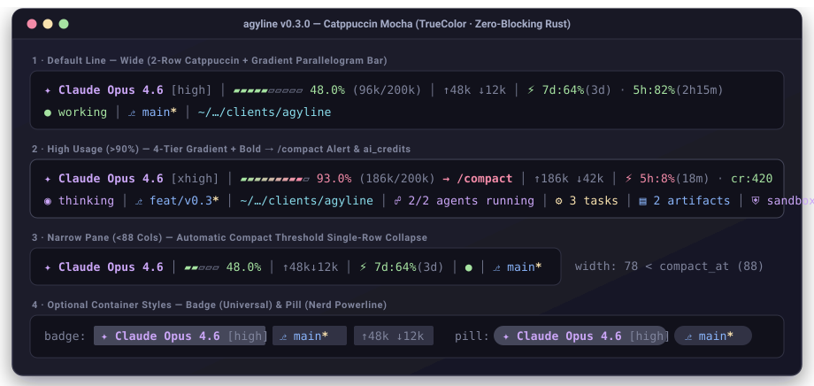

<div align="center">

# agyline

**Fast, zero-blocking, Catppuccin-styled status line for the Antigravity CLI (`agy`)**

[](Cargo.toml)
[](Cargo.toml)
[](Cargo.toml)

**English** | [简体中文](README.zh-CN.md)

<br />



</div>

`agyline` is a single-crate Rust status line and interactive terminal configurator for the Antigravity CLI (`agy`), occupying the same role [CCometixLine](https://github.com/Haleclipse/CCometixLine) fills for Claude Code while staying completely non-blocking on the hot render path.

---

## Highlights

- **Dual-polarity Catppuccin & Monochrome Palettes**: `palette = "catppuccin"` adapts automatically between **Catppuccin Mocha** (dark `Theme`) and **Catppuccin Latte** (light `Theme`) across 15 semantic tokens (including 4 urgency tiers `ok` / `warn` / `high` / `crit` and `surface` / `surface_hi` backgrounds); `theme = "auto"` checks `COLORFGBG` first and then the host OS app theme (Windows `AppsUseLightTheme`, zero subprocesses). Includes dual-polarity `mono`, `terminal`, 7 fixed-polarity RGB palettes, and custom `~/.gemini/agyline/palettes/*.toml`.
- **Smart Auto Color-Depth Detection**: `color_depth = "auto"` honors `NO_COLOR` and `TERM=dumb` first, downgrades macOS `Apple_Terminal` cleanly to 256-color, and promotes modern TrueColor terminals (`iTerm2`, `WezTerm`, `Ghostty`, `Kitty`, `Alacritty`, `VS Code`, `Windows Terminal`, `Warp`, `Hyper`, `Tabby`, `Rio`) ahead of generic `*256color` fallback.
- **Full-Bar Gradient `Usage Bar`s & `/compact` Alert**: Supports cap-height segmented `cells` (`❚❘`, alias `segments`, default), slanted `parallelogram` (`▰▱`, alias `blocks`), `braille` (`⣿⣤⣀`), `line` (`━╸─`), `solid`, `block`, and `ascii` bars. With `bar_gradient = true`, filled cells render across a vibrant 4-tier RGB urgency ramp (green → yellow → peach → red) while unfilled scale ticks carry polarity-softened hues of the same ramp—keeping low-percentage bars colorful yet clearly legible—and degrade losslessly across 256-color, 16-color, and ASCII terminals. The `context` bar shows `(used/window)` counts and appends a bold **`→ /compact`** alert at or above `context_crit` (default `90%`).
- **`Container Style` & Semantic Separators**: Switch row framing between separator-divided `minimal`, universal colored `badge` (no Nerd Font needed), and Powerline-capped `pill` (`\u{e0b6}` / `\u{e0b4}`), with automatic capability degradation (`pill` → `badge` on non-Nerd glyphs; `badge`/`pill` → `minimal` below 256 colors) and semantic `separator` aliases (`pipe`, `dashed`, `dot`, `square`, `none`, or custom text).
- **Responsive `Compact Threshold` Collapse**: Multi-row layouts automatically collapse into a single compact row below `compact_at` (default `88` columns; `0` disables) before `overflow = "fit"` priority narrowing runs—keeping narrow split panes wrap-free.
- **Focused 2-Row `Default Line` + Preserved Presets**:
  - **Row 1**: Bold model + deduplicated `[effort]` (honoring upstream `Response Model`), full-height segmented gradient `cells` context bar with `(used/window)` and `→ /compact`, compact `↑in ↓out` token counters, and urgency-sorted inline `@model` quota countdowns (`⚡ 7d:64%(3d) · 5h:82%(2h15m)`, falling back to `cr:<n>` from `ai_credits`).
  - **Row 2**: Lowercase `dot` agent status (`◉ thinking`, `● working`, `⚙ tool_use`, `✖ error`, `○ idle`, preserving `CONFIRM`), zero-blocking `⎇ branch*` Git indicator, home-tildefied middle-ellipsized path (`~/…/parent/leaf`), plus non-zero `subagents`, `tasks`, `artifacts`, and `sandbox`.
  - **Full Backward Compatibility**: `hud` (3-row `line` bar HUD), `classic` (2-row `@model` layout), and `cometix` (byte-exact `Reference Line`) presets remain preserved unchanged.
- **One-Line CLI & Zero-ANSI-Reparse TUI**: Configure in one command via `agyline set <key> [value]` and `agyline preview --showcase`, or run `agyline` in a terminal for the 4-tab interactive workbench sharing the exact live renderer.

---

## Rust Zero-Blocking Performance

Unlike PowerShell or Python status line scripts, `agyline` compiles to one native Rust binary: the live printing path **never spawns a shell**, **never waits on `git`**, parses stdin JSON streaming with **zero intermediate DOM trees**, and reads transcript start timestamps via an **O(1) `<= 4 KiB` header read**. Stale Git caches, prompt-cache relay touches, and optional full transcript token scans run asynchronously in detached background workers (`__refresh-git`, `__touch`, `__refresh-transcript`).

Measured on Windows `x86_64` (`rustc 1.88+`, `--release` profile):

### In-memory render microbenchmarks (`cargo bench --bench render_micro`, 1,000 samples)

| Workload | P50 | P95 | P99 |
| --- | ---: | ---: | ---: |
| `render + emit` (`default` wide Catppuccin gradient) | **5.70 µs** | 6.30 µs | 7.40 µs |
| `parse + render + emit` (`default` v0.3 full frame) | **7.90 µs** | 9.20 µs | 11.10 µs |
| `render + emit` (`default` `>90%` `→ /compact` crit) | **8.30 µs** | 9.00 µs | 9.50 µs |
| `render + emit` (`default` `badge` container) | **6.90 µs** | 8.90 µs | 9.90 µs |
| `render + emit` (`default` `pill` container) | **9.20 µs** | 9.90 µs | 10.90 µs |
| `render_with_width(78)` (`<88` auto-collapse) | **11.50 µs** | 12.20 µs | 13.00 µs |
| `render + emit` (`hud` 3-row baseline) | 13.70 µs | 15.20 µs | 20.20 µs |
| `render + emit` (`dashboard` 20-item) | 15.10 µs | 16.40 µs | 27.10 µs |

### End-to-end pipe benchmarks (`cargo bench --bench pipe_e2e`, Windows `x86_64`)

| Workload | N | P50 | P95 | P99 |
| --- | ---: | ---: | ---: | ---: |
| `default_catppuccin_warm` (direct binary) | 50 | **25.42 ms** | 28.50 ms | 29.05 ms |
| `default_badge_container` (direct) | 50 | **24.62 ms** | 26.52 ms | 26.59 ms |
| `default_pill_container` (direct) | 50 | **25.75 ms** | 27.62 ms | 28.35 ms |
| `default_compact_78` (`<88` collapse, direct) | 50 | **25.73 ms** | 27.58 ms | 27.95 ms |
| `multi_mb_transcript_5m` (5 MiB JSONL, direct) | 50 | **25.01 ms** | 28.65 ms | 29.08 ms |
| `cold_slow_git` (2,000 ms sleeping `git`, 22/22 workers spawned) | 20 | **41.51 ms** | 46.69 ms | 46.69 ms |
| `sqlite_lookup` (WAL `Response Model`, direct) | 50 | 28.33 ms | 30.76 ms | 30.87 ms |
| `sqlite_lock_contention` (EXCLUSIVE DB lock, direct) | 50 | 46.42 ms | 47.78 ms | 48.34 ms |
| `warm_cache` (`cmd /c` shell-wrapped comparison) | 50 | 59.46 ms | 65.14 ms | 74.88 ms |

---

## Quick Start & Installation

Requires **Rust 1.88+**. Official `agy` and `agy.exe` binaries stay completely untouched; `agyline` integrates only via `statusLine` in `~/.gemini/antigravity-cli/settings.json`.

```bash
# Build and install from this repository
cargo install --path . --locked

# Wire into ~/.gemini/antigravity-cli/settings.json (shows unified diff & saves rollback snapshot)
agyline install

# Or combine both with just
just install
```

### Verification & Safe Uninstall

```bash
just ci                    # fmt --check, clippy -D warnings, full test suite, bench --no-run
just sandbox-install-test  # end-to-end install / migrate / idempotent / restore / purge test
agyline uninstall          # restores previous statusLine from previous_statusline.json
agyline uninstall --reset --purge  # deletes AGYLINE_HOME only when it is a dedicated agyline dir
```

> `--purge` refuses the user home directory, `~/.gemini`, the settings directory, filesystem roots, symlinks, and any directory containing unrelated files—even when `-y` is passed.

---

## Quick CLI Reference

```bash
# Inspect active effective configuration and resolved config.toml path
agyline config

# List valid options for a key (exits 0 without writing)
agyline set palette
agyline set style
agyline set bar

# Update config.toml atomically in one line (honors AGYLINE_HOME, preserves unrelated keys)
agyline set preset hud            # default | hud | classic | cometix | minimal | dashboard | cache-focus
agyline set palette catppuccin    # catppuccin | mono | terminal | catppuccin-mocha | tokyo-night | nord | ...
agyline set theme auto            # auto | dark | light
agyline set style pill            # minimal | badge | pill
agyline set bar braille           # cells (alias: segments) | parallelogram (blocks) | braille | line | solid | block | ascii
agyline set bar-gradient true     # true | false (also on/off/1/0)
agyline set sep dashed            # pipe | dashed | dot | square | none | "<custom>"
agyline set compact-at 88         # 0..=500 (0 disables automatic single-row collapse)

# Stateless visual previews (zero writes under AGYLINE_HOME/state)
agyline preview --showcase              # palettes, >90% /compact, <88 collapse, badge/pill, separators
agyline preview --list                  # list all 9 built-in scenarios
agyline preview -s showcase_wide -w 120 # render one scenario at an explicit width
agyline preview --all --plain           # escape-free preview of every scenario
agyline preview --input frame.json      # preview a captured payload file (`-` for stdin)

# Version & troubleshooting
agyline version                         # alias for -V / --version
AGYLINE_DEBUG=1 agyline < frame.json    # best-effort dump of raw stdin to <AGYLINE_HOME>/state/last_payload.json
```

---

## Interactive TUI Configurator

Run `agyline` in an interactive terminal (or `agyline -c` / `--config`) to launch the 4-tab workbench:

- **`1: Layout`**: Multi-row editor (up to 5 rows), 24-item catalog, and per-slot Inspector (`style`, `bar_style`, `bar_width`, `show_tokens`, `label`, `family`, `max_levels`, `priority`, `fg`, `icon`, etc.).
- **`2: Style & Presets`**: Instant switching across all 7 presets (`All` / `Layout` / `Style` scope), all 10 built-in + custom palettes, `Container Style` (`minimal`/`badge`/`pill`), top-level `bar_style` & `bar_gradient`, semantic/custom `separator`, and `[palette_overrides]`.
- **`3: Thresholds & Runtime`**: Live-validated `compact_at`, `overflow`, `single_line`, four-tier `context_warn` / `context_high` / `context_crit`, four-tier `quota_warn` / `quota_high` / `quota_crit`, `cache_warn_secs`, `[git].cache_ms`, and `[cache_relay].url`.
- **`4: agy Hook`**: Unified diff preview for installing or restoring `statusLine` in `settings.json` without saving unsaved `config.toml` drafts.

Includes live shared preview (zero ANSI re-parsing), 100-step undo/redo (`Ctrl+Z` / `Ctrl+Y`), live read-only TOML drawer (`t`), `.bak` recovery for broken TOML, and external `mtime` conflict protection.

---

## Configuration (`config.toml` & Environment Overrides)

Configuration lives at `~/.gemini/agyline/config.toml` (relocated by `AGYLINE_HOME`). Custom presets live in `presets/*.toml` and custom palettes in `palettes/*.toml`.

```toml
version = 1
preset = "default"
palette = "catppuccin"        # dual-polarity: Mocha (dark) / Latte (light)
theme = "auto"                # auto | dark | light
glyphs = "nerd"               # nerd | unicode | ascii
color_depth = "auto"          # auto | truecolor | 256 | 16 | none
item_style = "minimal"        # minimal | badge | pill
bar_style = "cells"           # cells | parallelogram | braille | line | solid | block | ascii
bar_gradient = true           # full-bar 4-tier RGB gradient across filled & empty scale ticks
separator = " │ "             # or semantic preset: pipe | dashed | dot | square | none
indent = "  "
single_line = false
compact_at = 88               # auto-collapse multi-row layouts below 88 cols (0 = off)
overflow = "fit"              # fit | none

[thresholds]
context_warn = 60
context_high = 75
context_crit = 90
quota_warn = 40
quota_high = 25
quota_crit = 10
cache_warn_secs = 60

[git]
cache_ms = 2000

[cache_relay]
url = ""                      # loopback URL or empty/"off" to disable
```

### Preserved Environment Overrides

| Variable | Effect |
| --- | --- |
| `AGYLINE_HOME` | Relocates `config.toml`, custom `presets/`, `palettes/`, and `state/` (never relocates `agy`'s conversation DBs) |
| `AGY_THEME` | Forces `dark` or `light` polarity over `config.toml` (`COLORFGBG`, then OS light/dark theme, applies when `theme = "auto"`) |
| `AGY_STATUSLINE_LINES` | `1` forces single-line output ahead of `compact_at` |
| `AGY_STATUSLINE_INDENT` | Overrides row indent |
| `AGY_SHOW_DEFAULT_MODE` | `1` forces printing the default ask mode pill |
| `AGY_CACHE_RELAY` | Overrides `[cache_relay].url` (`off` skips relay state file and touches) |
| `AGYLINE_DEBUG` | `1` saves raw live stdin JSON best-effort to `<AGYLINE_HOME>/state/last_payload.json` (zero I/O otherwise) |

### Built-in Catalog Summary

- **7 Built-in Presets**: `default` (2-row Catppuccin gradient), `hud` (3-row `line` bar HUD), `classic` (2-row `@model`), `cometix` (byte-exact `Reference Line`), `minimal`, `dashboard`, `cache-focus`.
- **10 Built-in Palettes**: Dual-polarity `terminal`, `catppuccin`, `mono`; fixed-polarity `catppuccin-mocha`, `catppuccin-latte`, `tokyo-night`, `nord`, `gruvbox`, `rose-pine`, `dracula`.
- **24 Items**: Workspace (`model`, `dir`, `git`), Usage (`context`, `tokens`, `cache`, `speed`, `budget`, repeatable `quota` & `quota_group`, `cost`), Runtime (`status`, `mode`, `duration`, `subagents`, `tasks`, `queue`, `sandbox`), Session/Identity (`vim`, `title`, `agent`, `artifacts`, `version`, `plan`).

---

## Planned Distribution

Prebuilt release archives via GitHub Releases (Windows `msvc`, macOS, and static `musl` Linux across `x86_64` and `arm64`, matching official `agy` targets; same-OS invocation only, with no npm wrapper) are planned separately from local `cargo install --path .` builds.

---

## Appendix: Reference Baseline (`ref/agy-patch`)

Agent instructions and contribution contracts live in [AGENTS.md](AGENTS.md) and [GLOSSARY.md](GLOSSARY.md).

The gitignored `ref/agy-patch` directory holds the original local reference scripts (`statusline.ps1` and `statusline.py`, matching CCometixLine 2.0's `cometix` preset, `terminal` palette, and `plain` skin) that serve as the byte-exact parity baseline for `preset = "cometix"`. These files remain local reference material:

| Path | Role |
| --- | --- |
| `statusline.ps1`, `statusline.py` | Layout and byte-parity baseline for `preset = "cometix"` (`Reference Line`) |
| `install.ps1` | Legacy PowerShell hook installer reference |
| `cache_relay.py` | Local Cache Relay for prompt-cache keepalive; `agyline` reads its temp state file read-only (porting the relay to Rust is a separate decision) |
| `hub-wrapper.ps1`, `hub-wrapper.sh` | Gateway environment for a local CLIProxyAPI |
| `patch_agy.py`, `references/` | Mach-O patches and TUI notes for macOS `agy` |
| `consult_gemini/` | MCP server multiplexing Claude Code instances onto one `agy acp` process |
