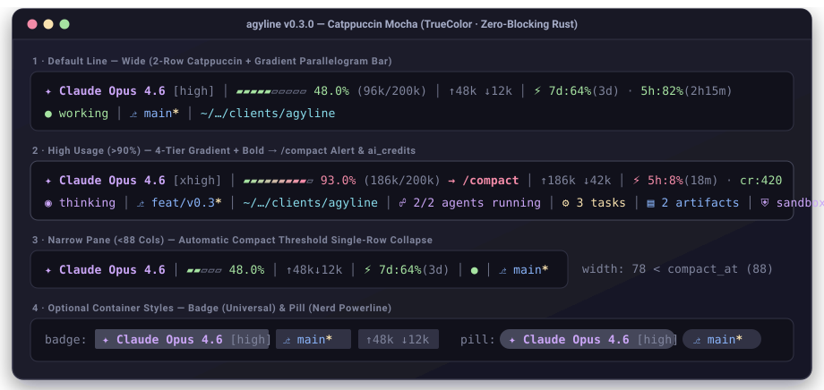

<div align="center">

# agyline

**为 Antigravity CLI（`agy`）打造的高速、零阻塞、Catppuccin 风格 Rust 状态栏**

[](Cargo.toml)
[](Cargo.toml)
[](Cargo.toml)

[English](README.md) | **简体中文**

<br />



</div>

`agyline` 是面向 Antigravity CLI（`agy`）的单一 Rust 二进制状态栏与交互式终端配置器，在 `agy` 中承担与 Claude Code 的 [CCometixLine](https://github.com/Haleclipse/CCometixLine) 相同的定位，同时在渲染热路径上保持严格零阻塞。

---

## 核心特性

- **双极性 Catppuccin 与 Monochrome 调色板**：内置 `palette = "catppuccin"` 在深色主题下自动切换为 **Catppuccin Mocha**、在浅色主题下自动切换为 **Catppuccin Latte**，覆盖 15 个语义颜色槽（含 `ok` / `warn` / `high` / `crit` 四级紧迫度与 `surface` / `surface_hi` 容器底色）。另提供双极性 `mono`、`terminal`、7 套固定极性 RGB 调色板，以及自定义 `~/.gemini/agyline/palettes/*.toml`。
- **智能色深自动探测**：`color_depth = "auto"` 优先遵守 `NO_COLOR` 与 `TERM=dumb`，在 macOS `Apple_Terminal` 上自动降级至 256 色，并在回退到泛用 `*256color` 前优先识别现代 TrueColor 终端（`iTerm2`、`WezTerm`、`Ghostty`、`Kitty`、`Alacritty`、`VS Code`、`Windows Terminal`、`Warp`、`Hyper`、`Tabby`、`Rio`）。
- **逐格渐变 `Usage Bar` 与 `/compact` 告警**：支持斜方块 `parallelogram`（`▰▱`，别名 `blocks`）、盲文 `braille`（`⣿⣤⣀`）、纯前景细轨 `line`（`━╸─`）、`solid`、`block` 与 `ascii` 样式；开启 `bar_gradient = true` 后在已填充格间执行轻量 RGB 线性插值渐变，并在 256 色 / 16 色 / ASCII 下无损降级且严格保持列宽。`context` 进度条支持显示 `(used/window)` token 比值，在达到 `context_crit`（默认 `90%`）时自动追加加粗 **`→ /compact`** 告警。
- **行级 `Container Style` 与语义分隔符别名**：支持在无框分隔 `minimal`、通用着色色块 `badge`（无需 Nerd Font）与圆角 Powerline 胶囊 `pill`（`\u{e0b6}` / `\u{e0b4}`）间切换，按终端能力自动降级（非 Nerd 字体时 `pill` → `badge`，低于 256 色时退回 `minimal`）；`separator` 支持语义预设（`pipe`、`dashed`、`dot`、`square`、`none`）及任意自定义文本。
- **窄屏 `Compact Threshold` 自动折叠**：当终端宽度低于 `compact_at`（默认 `88` 列，`0` 为关闭）时，多行布局先自动折叠为单行紧凑展示，再由 `overflow = "fit"` 执行优先级压缩，确保分屏窄窗口零折行。
- **精致 2 行新 `Default Line` + 完整历史预设兼容**：
  - **第一行**：加粗模型名 + 去重 `[effort]`（支持上游 `Response Model` 替换）、逐格渐变 `parallelogram` 上下文条（含 `(used/window)` 与 `→ /compact`）、紧凑 `↑in ↓out` token 计数，以及按模型优先与紧迫度排序的紧凑额度倒计时（`⚡ 7d:64%(3d) · 5h:82%(2h15m)`，配额稀疏或缺失时自动回退显示 `ai_credits` 的 `cr:<n>`）。
  - **第二行**：小写 `dot` 智能体状态（`◉ thinking`、`● working`、`⚙ tool_use`、`✖ error`、`○ idle`，紧凑态收起为单点但保留 `CONFIRM` 告警）、零阻塞 `⎇ branch*` Git 提示、主目录中段省略路径（`~/…/parent/leaf`），以及非零时显示的 `subagents`、`tasks`、`artifacts`、`sandbox`。
  - **既有预设零回退**：原 3 行 `hud`、2 行 `@model` 的 `classic` 与字节级对齐参考脚本的 `cometix`（`Reference Line`）预设完整保留。
- **一行式快捷 CLI 与零反解析交互式 TUI**：可用 `agyline set <key> [value]` 和 `agyline preview --showcase` 秒级调参预览，也可直接在终端运行 `agyline` 打开与实时输出共用同一渲染管线的四标签 TUI 工作台。

---

## Rust 零阻塞性能实测

不同于每次刷新都要拉起 PowerShell 或 Python 解释器的脚本，`agyline` 编译为单一原生 Rust 二进制：实时渲染路径**绝不启动 shell**、**绝不等待 `git`**、采用**零中间 DOM 树的流式 JSON 反序列化**，且对会话 transcript 仅执行 **O(1) `<= 4 KiB` 头部有界读取**。过期的本地 Git 缓存更新、Prompt Cache 中继保活 touch 与可选的完整 transcript 扫描均由后台分离工作进程（`__refresh-git`、`__touch`、`__refresh-transcript`）异步执行。

以下为 Windows `x86_64`（`rustc 1.88+`，`--release` 构建）实测数据：

### 内存渲染微基准（`cargo bench --bench render_micro`，每项 1,000 次采样）

| 场景 | P50 | P95 | P99 |
| --- | ---: | ---: | ---: |
| `render + emit`（`default` 宽屏 Catppuccin 渐变） | **5.70 µs** | 6.30 µs | 7.40 µs |
| `parse + render + emit`（`default` v0.3 完整单帧） | **7.90 µs** | 9.20 µs | 11.10 µs |
| `render + emit`（`default` `>90%` `→ /compact` 告警） | **8.30 µs** | 9.00 µs | 9.50 µs |
| `render + emit`（`default` `badge` 容器） | **6.90 µs** | 8.90 µs | 9.90 µs |
| `render + emit`（`default` `pill` 胶囊容器） | **9.20 µs** | 9.90 µs | 10.90 µs |
| `render_with_width(78)`（`<88` 自动单行折叠） | **11.50 µs** | 12.20 µs | 13.00 µs |
| `render + emit`（`hud` 3 行基线） | 13.70 µs | 15.20 µs | 20.20 µs |
| `render + emit`（`dashboard` 20 项） | 15.10 µs | 16.40 µs | 27.10 µs |

### 端到端管道进程基准（`cargo bench --bench pipe_e2e`，Windows `x86_64`）

| 场景 | N | P50 | P95 | P99 |
| --- | ---: | ---: | ---: | ---: |
| `default_catppuccin_warm`（直连二进制） | 50 | **25.42 ms** | 28.50 ms | 29.05 ms |
| `default_badge_container`（直连） | 50 | **24.62 ms** | 26.52 ms | 26.59 ms |
| `default_pill_container`（直连） | 50 | **25.75 ms** | 27.62 ms | 28.35 ms |
| `default_compact_78`（`<88` 折叠，直连） | 50 | **25.73 ms** | 27.58 ms | 27.95 ms |
| `multi_mb_transcript_5m`（5 MiB 大体积 JSONL，直连） | 50 | **25.01 ms** | 28.65 ms | 29.08 ms |
| `cold_slow_git`（2,000 ms 慢 `git`，22/22 后台分离触发） | 20 | **41.51 ms** | 46.69 ms | 46.69 ms |
| `sqlite_lookup`（WAL `Response Model` 查询，直连） | 50 | 28.33 ms | 30.76 ms | 30.87 ms |
| `sqlite_lock_contention`（EXCLUSIVE 排他锁退让，直连） | 50 | 46.42 ms | 47.78 ms | 48.34 ms |
| `warm_cache`（`cmd /c` 套壳对比） | 50 | 59.46 ms | 65.14 ms | 74.88 ms |

---

## 快速安装与验证

需要 **Rust 1.88+**。官方 `agy` / `agy.exe` 二进制保持原样不动，`agyline` 仅通过 `~/.gemini/antigravity-cli/settings.json` 中的 `statusLine` 接入。

```bash
# 从本仓库编译并安装
cargo install --path . --locked

# 接入 ~/.gemini/antigravity-cli/settings.json（写入前展示 unified diff 并自动留存回滚快照）
agyline install

# 或使用 just 一键安装
just install
```

### 校验与安全卸载

```bash
just ci                    # fmt --check、clippy -D warnings、全量测试与 bench --no-run
just sandbox-install-test  # 隔离沙箱端到端验证 install / migrate / 幂等 / 恢复 / purge
agyline uninstall          # 从 previous_statusline.json 精确还原原有 statusLine
agyline uninstall --reset --purge  # 仅当 AGYLINE_HOME 为专用绝对目录时才删除
```

> `--purge` 即便搭配 `-y` 也会拒绝删除用户主目录、`~/.gemini`、settings 所在目录、文件系统根目录、符号链接，以及包含其他无关文件的目录。

---

## 快捷 CLI 速查

```bash
# 查看当前生效配置与 config.toml 路径
agyline config

# 省略值时列出合法候选项（退出码 0，不写磁盘）
agyline set palette
agyline set style
agyline set bar

# 一行原子更新 config.toml（遵循 AGYLINE_HOME，保留其余配置项）
agyline set preset hud            # default | hud | classic | cometix | minimal | dashboard | cache-focus
agyline set palette catppuccin    # catppuccin | mono | terminal | catppuccin-mocha | tokyo-night | nord | ...
agyline set theme auto            # auto | dark | light
agyline set style pill            # minimal | badge | pill
agyline set bar braille           # parallelogram（别名 blocks）| braille | line | solid | block | ascii
agyline set bar-gradient true     # true | false（亦支持 on/off/1/0）
agyline set sep dashed            # pipe | dashed | dot | square | none | "<自定义>"
agyline set compact-at 88         # 0..=500（0 关闭自动折叠）

# 无状态视觉预览（绝不写入 AGYLINE_HOME/state）
agyline preview --showcase              # 一屏对比调色板、>90% /compact、<88 折叠、badge/pill 与分隔符
agyline preview --list                  # 列出全部 9 个内置场景
agyline preview -s showcase_wide -w 120 # 指定场景与列宽预览
agyline preview --all --plain           # 输出全部场景的纯文本视图
agyline preview --input frame.json      # 预览本地抓取的载荷文件（`-` 表示标准输入）

# 版本查询与载荷排障
agyline version                         # 等价于 -V / --version
AGYLINE_DEBUG=1 agyline < frame.json    # 尽力将原始 stdin 载荷保存至 <AGYLINE_HOME>/state/last_payload.json
```

---

## 交互式终端配置器（TUI）

在终端直接运行 `agyline`（或 `agyline -c` / `--config`）即可打开四标签工作台：

- **`1: Layout`**：动态多行编辑（最多 5 行）、24 项目录浏览器与逐槽位检查器（支持 `style`、`bar_style`、`bar_width`、`show_tokens`、`label`、`family`、`max_levels`、`priority`、`fg`、`icon` 等全部选项）。
- **`2: Style & Presets`**：按 `All` / `Layout` / `Style` 作用域切换 7 套内置预设，选择 10 套内置及自定义调色板、`Container Style`（`minimal`/`badge`/`pill`）、全局 `bar_style` 与 `bar_gradient`、语义/自定义 `separator` 与 `[palette_overrides]`。
- **`3: Thresholds & Runtime`**：实时校验 `compact_at`、`overflow`、`single_line`、四级 `context_warn` / `context_high` / `context_crit`、四级 `quota_warn` / `quota_high` / `quota_crit`、`cache_warn_secs`、`[git].cache_ms` 与 `[cache_relay].url`。
- **`4: agy Hook`**：独立预览并确认 `settings.json` 的 unified diff 接入或恢复，不隐式覆盖未保存的 `config.toml` 草稿。

内置与实时状态栏 1:1 共享的无损预览（零 ANSI 反解析）、100 步撤销/重做（`Ctrl+Z` / `Ctrl+Y`）、实时只读 `TOML` 抽屉（`t`）、损坏配置 `.bak` 保护以及外部 `mtime` 冲突检测。

---

## 配置参考（`config.toml` 与环境变量覆盖）

配置文件默认位于 `~/.gemini/agyline/config.toml`（可通过 `AGYLINE_HOME` 重定位）；自定义预设放在 `presets/*.toml`，自定义调色板放在 `palettes/*.toml`。

```toml
version = 1
preset = "default"
palette = "catppuccin"        # 双极性：深色 Mocha / 浅色 Latte
theme = "auto"                # auto | dark | light
glyphs = "nerd"               # nerd | unicode | ascii
color_depth = "auto"          # auto | truecolor | 256 | 16 | none
item_style = "minimal"        # minimal | badge | pill
bar_style = "parallelogram"   # parallelogram | braille | line | solid | block | ascii
bar_gradient = true           # 启用进度条逐格 RGB 线性渐变
separator = " │ "             # 或语义别名：pipe | dashed | dot | square | none
indent = "  "
single_line = false
compact_at = 88               # 低于 88 列自动折叠为单行（0 关闭）
overflow = "fit"              # fit | none

[thresholds]
context_warn = 60
context_high = 75
context_crit = 90
quota_warn = 40
quota_high = 25
quota_crit = 10
cache_warn_secs = 60

[git]
cache_ms = 2000

[cache_relay]
url = ""                      # 本机回环 URL；留空或 "off" 关闭
```

### 保留的环境变量覆盖

| 变量 | 作用 |
| --- | --- |
| `AGYLINE_HOME` | 重定位 `config.toml`、自定义 `presets/`、`palettes/` 与 `state/`（不影响 `agy` 自身的对话数据库目录） |
| `AGY_THEME` | 强制指定 `dark` 或 `light` 极性，覆盖 `config.toml`（`COLORFGBG` 仅在 `theme = "auto"` 时生效） |
| `AGY_STATUSLINE_LINES` | 设为 `1` 强制单行输出，优先级高于 `compact_at` |
| `AGY_STATUSLINE_INDENT` | 覆盖行首缩进 |
| `AGY_SHOW_DEFAULT_MODE` | 设为 `1` 强制显示默认 ask 模式徽章 |
| `AGY_CACHE_RELAY` | 覆盖 `[cache_relay].url`（设为 `off` 跳过中继状态文件与保活 touch） |
| `AGYLINE_DEBUG` | 设为 `1` 时尽力将实时原始 stdin JSON 写入 `<AGYLINE_HOME>/state/last_payload.json`（其余值零额外 I/O） |

### 内置目录一览

- **7 套内置预设**：`default`（2 行 Catppuccin 渐变默认行）、`hud`（3 行 `line` 细轨 HUD）、`classic`（原 2 行 `@model` 布局）、`cometix`（与 `Reference Line` 字节级一致）、`minimal`、`dashboard`、`cache-focus`。
- **10 套内置调色板**：双极性 `terminal`、`catppuccin`、`mono`；固定极性 `catppuccin-mocha`、`catppuccin-latte`、`tokyo-night`、`nord`、`gruvbox`、`rose-pine`、`dracula`。
- **24 项状态目录**：工作区（`model`、`dir`、`git`）、用量（`context`、`tokens`、`cache`、`speed`、`budget`、可重复添加的 `quota` 与 `quota_group`、`cost`）、运行态（`status`、`mode`、`duration`、`subagents`、`tasks`、`queue`、`sandbox`）、会话标识（`vim`、`title`、`agent`、`artifacts`、`version`、`plan`）。

---

## 后续发布规划

通过 GitHub Releases 分发预编译包（Windows `msvc`、macOS 与纯静态 `musl` Linux，覆盖 `x86_64` 与 `arm64` 对齐官方 `agy` 发行目标；同系统原生运行，不做 npm 包装）独立于本仓库本地 `cargo install --path .` 构建进行规划。

---

## 附录：参考基线（`ref/agy-patch`）

代理协作约定与领域术语分别维护在 [AGENTS.md](AGENTS.md) 与 [GLOSSARY.md](GLOSSARY.md)。

已写入 `.gitignore` 的 `ref/agy-patch` 目录存放了早期本机参考脚本（`statusline.ps1` 与 `statusline.py`，对齐 CCometixLine 2.0 的 `cometix` 预设、`terminal` 配色与 `plain` 皮肤），作为 `preset = "cometix"` 的字节级一致性基线。以下内容继续保留在参考目录中：

| 路径 | 作用 |
| --- | --- |
| `statusline.ps1`、`statusline.py` | `preset = "cometix"`（`Reference Line`）的布局与字节一致性基线 |
| `install.ps1` | 早期 PowerShell hook 接入脚本参考 |
| `cache_relay.py` | 提示缓存保活中继；`agyline` 只读其临时状态文件（是否用 Rust 重写中继另行决定） |
| `hub-wrapper.ps1`、`hub-wrapper.sh` | 本地 CLIProxyAPI 网关环境 |
| `patch_agy.py`、`references/` | macOS `agy` 二进制的 Mach-O 补丁与 TUI 笔记 |
| `consult_gemini/` | 将多个 Claude Code 实例复用到单个 `agy acp` 进程的 MCP 服务 |
